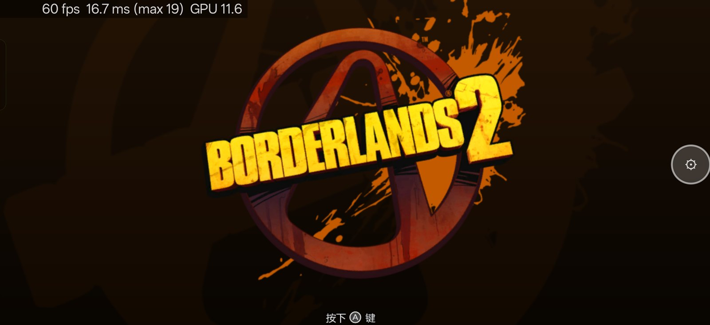
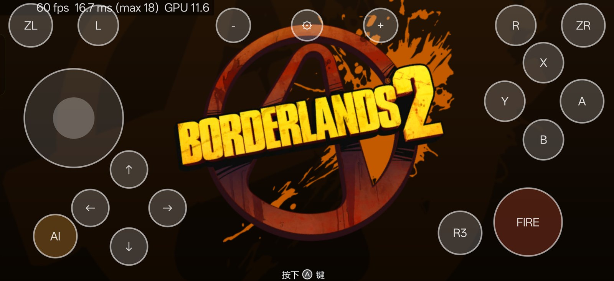
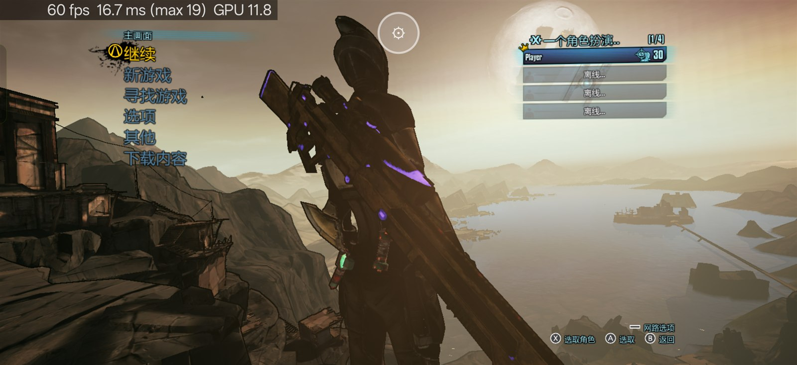
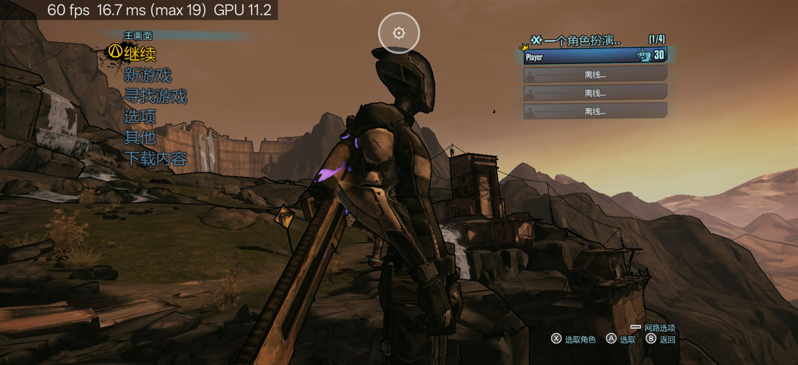
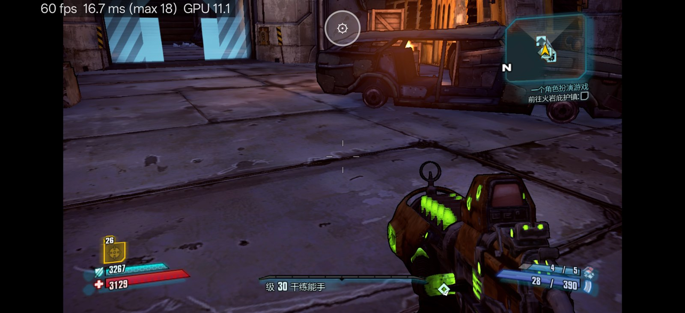
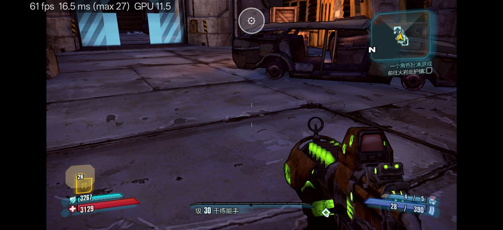
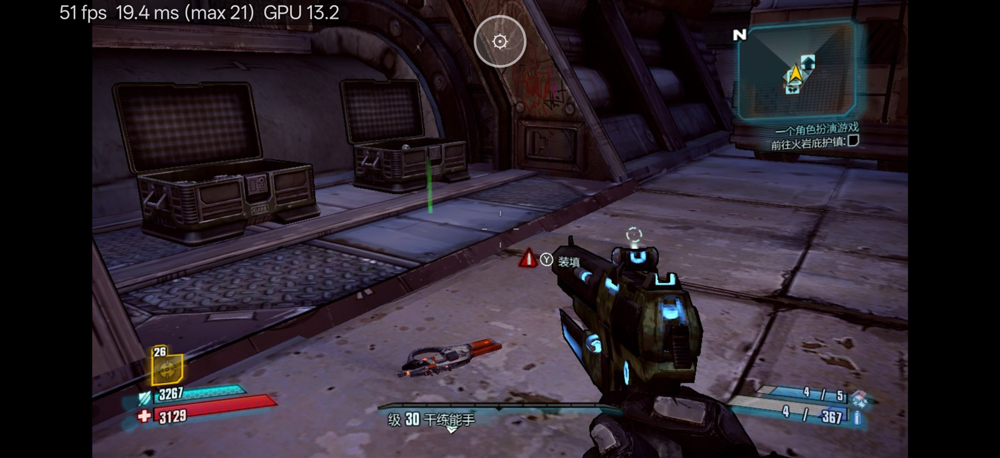
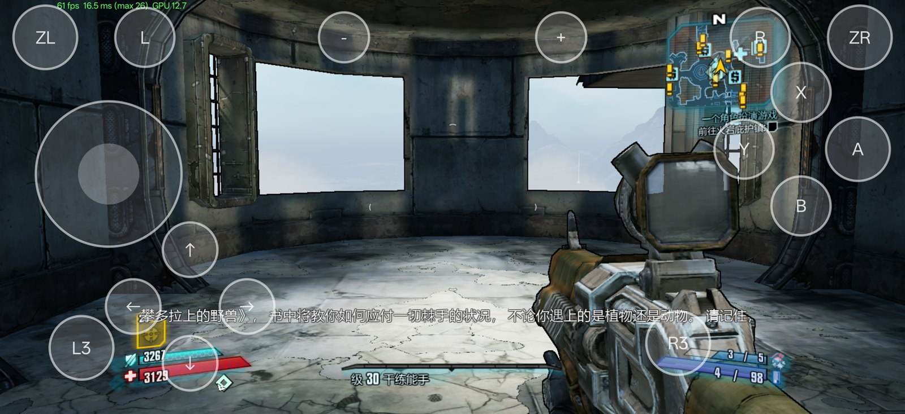
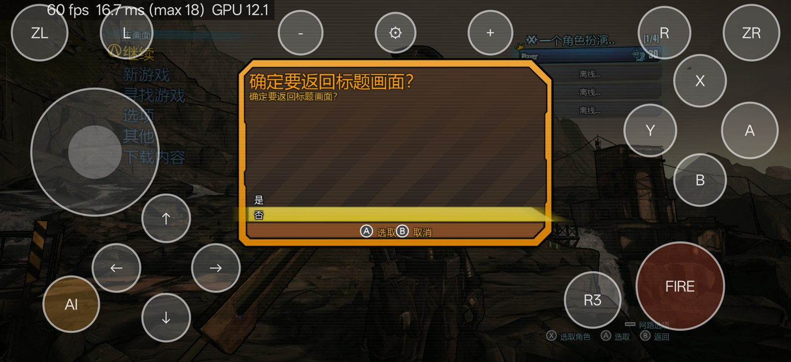
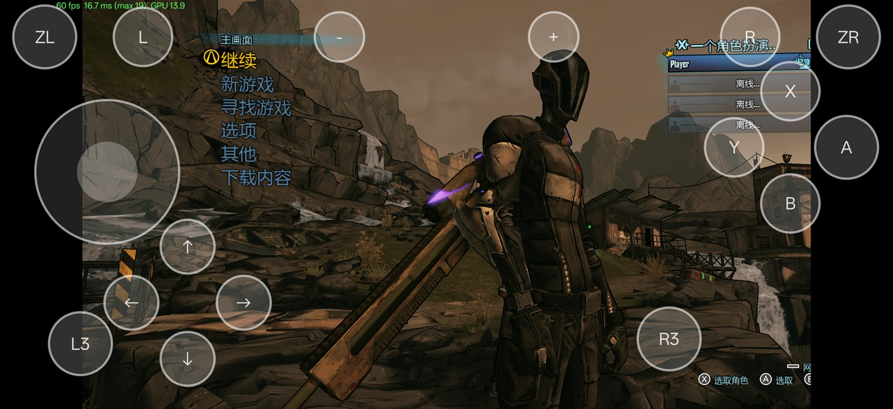

# Borderlands 2 (Switch) on Android

A native Android port of **Borderlands 2** for Nintendo Switch, built on the DM NVN HLE
framework. The game's own AArch64 code runs directly on the phone's CPU; the host implements
the Switch system services (`nn::` HLE) and replays the NVN graphics API on Vulkan. You bring
the game: this repository contains no game content, no keys and no APKs built from them.

> **This repository is the Borderlands 2 port.**
> It is **not** the Divinity: Original Sin 2 port. The framework, tools and most of the host
> code are shared with [Divinity: Original Sin 2 Mobile](https://github.com/Desm0nt/divinity-original-sin-2-port)
> (upstream), and that project's original documentation is kept here as
> [README-DOS2.md](README-DOS2.md) for reference.

Status: **playable end to end at a locked 60 FPS**, with a clean picture, low power draw and
touch controls built for a phone. Validated on one device — **realme RMX8899 / Snapdragon
SM8845 / Adreno 829 / Android 17**. Other GPUs and drivers are not guaranteed to work.

## Highlights

- **Actually playable** — boots into the campaign and plays through on a phone, with no
  emulator or compatibility layer in the middle.
- **Clean picture** — every shader key is translated and merged, including the two-part
  vertex programs the engine relies on, plus the clip-space depth fix and `spirv-opt`
  normalisation the Adreno compiler needs. No black screens, missing geometry or broken
  effects on the validated device.
- **Locked 60 FPS** — steady frame pacing at the screen's own aspect, using the port's
  presentation tuning (`DM_VK_PRESENT=mailbox`, 240 Hz present cap, wide present).
- **Low power, low heat** — the game's own AArch64 code runs natively, so there is no CPU
  emulation burning battery; long sessions stay comfortable thermally.
- **Touch controls made for a phone** — transparent on-screen pad, hold-to-fire where the
  same finger slides to aim, gyro aiming from the phone's own sensor, and a full-size look
  area.
- **Code only** — no game data, no keys and no game-derived APKs in this repository.

## Screenshots

Captured on the phone (realme RMX8899, Snapdragon SM8845, Adreno 829) at the screen's native
aspect. The counter in the top-left corner is the port's own FPS overlay; most of these
shots show the game holding 60 FPS, and the transparent pad is the port's touch layout.

| | |
|---|---|
|  |  |
|  |  |
|  |  |
|  |  |
|  |  |

## Before you change anything

> [!WARNING]
> **Do not poke at settings you do not understand, and do not run console commands you do not
> understand.**
>
> - **Settings → Graphics** — the port's own switches (`DM_3D_SCALE`, present mode, graphics
>   slots) change how the game renders. Random values can give you a black screen, a stretched
>   picture or a slideshow.
> - **Console commands** — `dm/cheat.req` can crash the game or damage a save. Back up
>   `Download/Borderlands2Mobile/saves/` before experimenting, and only run the commands you
>   actually understand ([docs/BL2-CHEATS.md](docs/BL2-CHEATS.md)).
> - **If the picture breaks**, press the game's own **Restore Default Graphics** first, then undo
>   your last `dm/env` change. A broken picture is almost always a setting, not a broken port.
>
> 中文：设置/图形里不懂的选项不要乱点，控制台命令不懂的不要乱用；画面出错时先点游戏里的
> “恢复默认图形”，再回退 `dm/env` 的改动。

## Start here

| Document | Contents |
| --- | --- |
| [README-BL2.md](README-BL2.md) | Build and run: data layout on the phone, `dm/env` switches, APK build, shader bundles |
| [docs/BL2-PORT-STATUS.md](docs/BL2-PORT-STATUS.md) | What works, what is still open (HD textures, per-device validation) |
| [docs/BL2-CHEATS.md](docs/BL2-CHEATS.md) | The `cheat.req` console and the AI-teammate hooks |
| [docs/BL2-NPU-AI-TEAMMATE.md](docs/BL2-NPU-AI-TEAMMATE.md) | Design discussion: an NPU-driven AI teammate that does not reuse the game's AI |
| [Discussion #22](https://github.com/biigdrong/borderlands2-mobile/discussions/22) | AI / NPU teammate — open questions and alternative approaches |

Questions about the NPU teammate design go to Discussion #22 rather than the issue tracker;
it keeps the AI thread in one place.

## What it is

- The original game code executing **natively** on the phone — no emulated CPU, no JIT.
  Switch and Android phones share the AArch64 instruction set; an offline rewriter
  (`dm/tools/patch_nso.py`) changes only the instructions that cannot run unchanged on Linux
  into calls to the host.
- An HLE host for the Horizon OS services the game uses, and an NVN → Vulkan recorder
  tuned for Adreno. The game's shaders are translated to SPIR-V offline on your PC.
- A phone port with touch control, widescreen presentation at the screen's own aspect, and
  the shared settings of the other DM ports (DOOM, Diablo III, Torchlight II, DOS2).

## What it is not

- An emulator, cloud gaming or streaming.
- **A source of game content.** Dump the game from a Switch you own and convert it on your
  PC. Do not commit or share the dump, the generated `*.xgs` shaders, or APKs built from it.
- Affiliated with Gearbox Software, 2K or Nintendo.

## Upstream

This tree is a fork of [divinity-original-sin-2-port](https://github.com/Desm0nt/divinity-original-sin-2-port)
built with `DM_GAME=bl2`. Framework-level documentation (install flow, driver packaging,
dependency list) still lives in that project and is mirrored under [docs/upstream](docs/upstream)
and [README-DOS2.md](README-DOS2.md).
