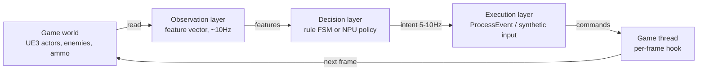

# AI teammate driven by the phone's NPU — design discussion

**Status: design exploration, nothing implemented.** This document records an approach for
a real AI teammate in the BL2 port that does **not** reuse the game's own AI strategy.
Feedback and better ideas are welcome — see [Open questions](#open-questions).

## Goal

Make a companion pawn that follows the player, picks targets, takes cover and shoots, with
its *decisions* produced by a model running on the phone NPU instead of the game's
`AIController` / behaviour tree.

## What "replace the game AI" actually means

The game's AI is two layers bundled together, and only one of them should be replaced:

| Layer | Content | Replace? |
| --- | --- | --- |
| Decision | target selection, movement intent, fire timing, reload, retreat | **Yes** — this is the NPU's job |
| Execution | NavMesh pathing, AnimMontage, weapon traces, hit detection | **No** — keep the engine |

Replacing both produces a pawn that cannot walk, cannot shoot, and gets stuck on geometry.
The practical split: stop the stock controller from *deciding*, but let it keep *driving*.
`SetAllegiance` (already used by the `ally` command) is the same idea in a cruder form.

## Architecture



Each layer maps onto code that already exists in the port.

### Observation layer

Every ~100 ms, on the game thread, walk the level and build a fixed-size feature vector.
The probe already contains the primitives: `objs`, `aiprobe`, `aiprops`, `aiprops2`,
`mindfns` in `dm/host/hle_bl2_probe.c`.

```
self:     position, yaw, health, shield, ammo, weapon class, skill cooldowns
enemy[i]: relative bearing (polar), distance, health, line-of-sight, is_firing
world:    forward trace distance, cover direction, teammate positions
```

This must run inside `dm_bl2_cheat_tick` (i.e. on the game thread). Reading UE3 objects
from a host thread will eventually crash.

### Decision layer (the NPU part)

Output is a small set of discrete intents, not analogue stick values:

```
target slot (0-3) | movement intent (8-way + idle) | action (fire / reload / skill / retreat / follow)
```

5-10 Hz is enough. Human FPS reaction time is 150-250 ms; there is no reason to decide at
60 Hz.

### Execution layer

Two channels, both already available:

- **Synthetic gamepad input** through the existing HID / touch path — safest, zero crash risk
- **`ProcessEvent` calls** through the `cheat.req` channel (`dm/host/hle_bl2_probe.c`) for
  precise actions: switch weapon, fire skill, target a specific actor

## NPU constraints that shape the design

1. **Latency budget is 30-50 ms, not 16.7 ms.** At 10 Hz there is ~50 ms of slack per tick.
   A 1-5 M parameter int8 policy is 2-10 MB and runs in 5-15 ms on a Hexagon HTP. What does
   not work is running inference every frame — do not design for that.
2. **Runtime choice decides whether it ships.** Snapdragon: QNN / LiteRT QNN delegate has
   the best operator coverage. Dimensity: the APU goes through NNAPI and coverage is
   uneven — a **CPU fallback is mandatory**, otherwise half the devices get nothing. This is
   the same per-device degradation logic already used by `DM_VK_DRIVER`.
3. **Power is about duty cycle, not model size.** 10 Hz x 10 ms is ~10% NPU duty and fine.
   30 Hz x 30 ms will thermal-throttle the phone in ten minutes. A policy network is a
   naturally low-frequency workload, which helps.
4. **Vision models are low-frequency only.** A 1-3 B int4 VLM runs at 0.5-1 Hz at best.
   Use it as a semantic prior (scene / enemy type), never for real-time aiming.
5. **Training data is the bottleneck, not compute.** Without data the NPU is just a warm
   piece of silicon.

## Execution strategies, ranked by risk

| Strategy | Stability | Expressiveness | Effort |
| --- | --- | --- | --- |
| Synthetic gamepad input | highest | medium (turn latency) | low |
| UE3 function calls (`ProcessEvent`) — recommended primary | medium-high | high | medium |
| Take over / replace `AIController` | low (crashes, stalls) | highest | high |

Recommended: **function calls plus input synthesis**, and keep full controller takeover as
a last resort.

## Phased plan

**P0 — close the loop (no NPU).** Observation produces features, a rule FSM (turn toward
the nearest visible enemy, fire) drives the execution layer. The goal is a dumb but
functional teammate that follows and shoots. This validates *channel reliability*, not
intelligence.

**P1 — flesh out the rules.** Cover checks, threat scoring
(`distance / health / is_shooting_at_me`), ammo management, formation following. Pure
hand-written logic, no model. **Once this is done the teammate is already usable** — do not
skip it.

**P2 — let the NPU decide.** Train a small policy by behaviour cloning on the state/action
pairs logged in P0/P1, then swap the FSM's scoring function for a forward pass. The
architecture does not change; only "if-else scoring" becomes "network scoring". The gain is
generalisation, not a step change.

**P3 — vision and learning.** Add a low-frequency VLM prior, or RL fine-tuning. Research
grade, worst return on effort; keep it behind a switch.

## Risks

1. **Thread safety of memory reads.** Feature extraction must stay on the game thread.
2. **Version drift.** All offsets must come from symbol / name-table scans, never hard-coded
   — the probe already rescans after a level change; the AI layer must do the same.
3. **Distribution hygiene.** Single-player and offline, but the public repo must not ship
   game data or game assets pulled from a training set. Same rule as README section 0.
4. **Per-SoC NPU differences.** Operator coverage varies; CPU fallback and a feature flag
   per backend are required.

## Open questions

- Is there a cleaner way to halt the stock `AIController` decision step while keeping its
  pathing and animation, short of replacing the controller class?
- Has anyone got reliable `NavMesh` / cover queries exposed through `ProcessEvent` on this
  build?
- Which NPU path has actually worked on this engine on non-Snapdragon devices — NNAPI,
  LiteRT with a vendor delegate, or CPU only?
- Is there an existing behaviour-cloning dataset or a better way to label human play than
  dumping state/action pairs from the probe?

## Summary

Roughly 80% of the work is the observation and execution loop; the NPU is the last 20%.
Get P0/P1 working first, then the model has something to plug into.
